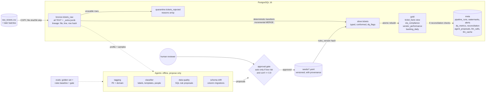

# AI-assisted medallion pipeline: facilities maintenance tickets

A bronze, silver and gold pipeline for `data/raw_tickets.csv` (10,280 tickets) on PostgreSQL. **Four
LLM agents** propose schema, quality rules, classifications and PII tags. **Nothing an agent produces
reaches silver until it passes an approval gate**. The classifier is scored against a golden set *and*
a plain-rules baseline; DQ has issue-coverage and executable-predicate evaluations.

```bash
make run          # one command: Postgres up, then ingest, silver, gold, reconcile, metrics. No API key needed.
```

Without make, `docker compose up --build --exit-code-from pipeline` does the same; run logs then record
`git_sha=unknown` unless `GIT_SHA` is set, because the container has no git.

Only Docker is required. `make run` uses the **reviewed, committed** agent output in `seeds/`, so it is
deterministic and offline. To regenerate that output with a live model, run `cp .env.example .env`, set
`LLM_API_KEY`, then `make agents`. See [Running the agents](#running-the-agents).

---

## Contents

1. [Architecture](#1-architecture)
2. [Layers](#2-layers): bronze, silver, gold, lineage, rerun safety, logging
3. [The agents: assessment with real input and output](#3-agents-assessment-with-real-input-and-output)
4. [Governance: approval gate, evals, promotion](#4-governance-approval-gate-evals-promotion)
5. [Observability, incremental loads and drift](#5-observability-incremental-loads-and-drift)
6. [What changes at 100x](#6-what-changes-at-100x)
7. [Where AI did not help](#7-where-ai-did-not-help-and-what-i-would-do-differently)
8. [Time spent](#8-time-spent)
9. [Repo map and commands](#9-repo-map-and-commands)

Deeper docs:

- [docs/cleaning_rules.md](docs/cleaning_rules.md): every silver rule, with evidence counts.
- [docs/lineage.md](docs/lineage.md): one ticket traced from gold back to its CSV line.
- [docs/scale_100x.md](docs/scale_100x.md)
- [docs/adr/0001-storage-choice.md](docs/adr/0001-storage-choice.md): why Postgres and not DuckDB,
  ClickHouse, Spark or Snowflake.
- [docs/agent_assessment.md](docs/agent_assessment.md): full agent outputs and the time log.

---

## 1. Architecture



**Main decision: agents are compilers, not runtime dependencies.** They run offline and label the
*distinct vocabulary* of the data:

- 99 category labels;
- 98 description templates, 30 of which turn out to be junk or category words typed into the description;
- 33 people.

They do not label 10k rows. A person approves the output, it is written to YAML seed files with
provenance, and silver joins those seeds deterministically. As a result:

- **Repeatable.** The silver build never calls a model. Rebuilding twice gives identical output (tested).
- **Cheap at scale.** Cost grows with new vocabulary, not rows. All four agents together cost **$0.17** on
  gpt-5-mini; per-row classification would cost about $10 (see [§6](#6-what-changes-at-100x)).
- **Reviewable.** Every enrichment in silver traces back to a proposal id, an approver, a model, a
  prompt version and a confidence (`_provenance` in the seed files).
- **Survives model outages.** If the LLM is down, the daily load still runs. New vocabulary lands as
  `Unclassified` and raises an alert.

**Storage:** one Postgres instance, one schema per layer. It is the right size for 10k rows and the
brief's "no over-engineering" rule, and it is strongest at the transactional bookkeeping this design relies
on (proposals, watermarks, cache, run log). The trade-offs against DuckDB, ClickHouse, Spark/Iceberg and
Snowflake/Databricks are in the [ADR](docs/adr/0001-storage-choice.md), and the production mapping is in
[§6](#6-what-changes-at-100x).

---

## 2. Layers

### Naming and separation

| Schema | Owner | Contents | Who reads it |
|---|---|---|---|
| `bronze` | ingest | `tickets_raw`: the source as-is, every column `TEXT`, unknown columns in `_extra jsonb` | pipeline, agents (read-only) |
| `silver` | silver build | `tickets`: one row per ticket, typed, conformed, `dq_flags text[]` | analysts, gold |
| `quarantine` | silver build | `tickets_rejected`: rows that cannot be placed in time, with `reasons[]` and the raw row | data stewards |
| `gold` | gold build | business marts only | BI / stakeholders |
| `meta` | everything | run log, watermarks, alerts, metrics, proposals, LLM log and cache | platform team |

Columns starting with `_` are lineage and control columns. `*_raw` columns keep the original value next to
the typed one.

### Bronze: land everything, lose nothing

- `COPY` into all-`TEXT` columns (schema-on-read). An upstream type change cannot fail the load.
- **Lineage per row:** `_source_file`, `_source_file_sha256`, `_row_number` (the CSV line), `_row_hash`,
  `_ingested_at`, `_batch_id` (the load, joined to `meta.ingested_files` and the run log).
- **Rerun safety at file level:** a file whose sha256 is already in `meta.ingested_files` is skipped, and
  `UNIQUE(_source_file_sha256, _row_number)` is a backstop. Rerunning `make run` loads 0 rows (tested).
- **Drift:** the header is compared with `meta.schema_registry`. New columns go to `_extra`, an alert is
  raised, and the drift agent drafts a migration (see [§5](#5-observability-incremental-loads-and-drift)).

### Silver: deterministic, explained cleaning

Every rule, and the counts that justify it, is in **[docs/cleaning_rules.md](docs/cleaning_rules.md)**. The
main ones:

| Problem in the raw data | Silver result |
|---|---|
| 8 timestamp formats, including epochs; `asap`, `TBD`, `00/00/0000` | Parsed explicitly. **Month-first is proven by the data** (2,819 values only make sense that way; none make sense day-first). 30 rows without a usable `created_at` are quarantined. |
| 1,866 tickets resolved before they were created; 2,127 open tickets with a resolve date | Values kept, flagged, excluded from duration metrics |
| 115 category spellings, 46 swapped category/description pairs | 10 taxonomy categories through agent-proposed, human-approved label seeds; swaps fixed and flagged |
| Free-text descriptions | 98 templates, each labeled once with asset, issue, urgency and safety. Floor, room and asset id come from regex. |
| `$1,234.50`, `-1`, `N/A`, `999`-hour SLAs | Typed; sentinels become NULL with a flag; a policy SLA fills gaps, recorded in `sla_source` |
| `J. Doe` vs `Jane Doe`, `M. Johnson` (Mike or Michael?) | Safe merges applied; ambiguous ones left alone and flagged |
| Content duplicates, repeated ticket ids | Linked through `duplicate_of_key`; a single winner per id by status rank, then completeness, then recency |
| 823 "duplicate of #N" notes | **Not** used for duplicate removal: only 56 point to the same building. Kept as `claimed_duplicate_of`. |

**Rerun safety and incremental loads:** silver reads bronze rows past the watermark *plus a 48h replay
window*, recomputes the winner for each affected ticket, stages the result, and runs one `MERGE`. Changing
any seed file changes `rules_version`, which forces a full rebuild. The tests check that a rerun with no new
rows is a no-op and that two full rebuilds give byte-identical output.
Silver uses one repeatable-read snapshot and advances its watermark only to the newest row it actually
processed. A batch arriving during the build is left for the next run. Bronze serializes CSV writers so
their ingest timestamps follow commit order; the regression suite exercises overlapping ingestion.

**Result on the supplied file** (clean `make reset && make run`, about 5 seconds):

- 10,280 bronze rows become 10,250 silver rows and 30 quarantined rows (23 with a placeholder
  `created_at`, 7 with none, 8 junk records; a row can have several reasons).
- One silver row is a content duplicate, so `gold.ticket_facts` holds 10,249 tickets.
- 46 swapped category/description pairs are fixed and flagged.
- 190 tickets (1.9%) keep an unmapped template, 166 of them from the one template I rejected. They raise
  the `unmapped_descriptions` alert instead of being guessed.
- A second `make run` loads 0 rows and changes nothing.

### Gold: four objects, each answering one question

| Object | Grain | Business question | Why this grain |
|---|---|---|---|
| `gold.ticket_facts` (view) | ticket | "Give me one trustworthy row per real ticket." Excludes content duplicates; fixes `as_of` to the latest event in the data (created or resolved), so open-ticket SLA age is repeatable. | The shared, conformed base every mart reads from, so all marts use one definition of "resolved", "breached" and "open". |
| `gold.sla_compliance` | month × category × priority | "Are we meeting SLA, where not, and is it getting worse?" Breach rate, p50/p90 resolution hours, **share of SLAs filled by policy**, so the reader knows how much is assumed. | The FM manager's monthly review grain. Priority is included because SLA targets depend on it. |
| `gold.vendor_performance` | assignee × category | "Which vendors are fast, cheap and doing the work they're contracted for?" Volume, breach rate, median hours, cost per ticket, **share outside contracted scope**. | Contract reviews happen per vendor and trade. |
| `gold.backlog_daily` | day × building | "How big is the open backlog, and where?" Opened, closed, cumulative open, critical open. | Site managers own buildings. Daily is the finest grain that stays meaningful for this volume. |

**What gold says about this file.** These are findings about the data, not bugs:

- **SLA compliance is almost zero.** 6,958 of 10,249 tickets (68%) are still open, and 6,949 of those are
  past SLA at `as_of` (2025-07-29). Closed tickets are no better: 2,388 of the 2,394 with a measurable
  duration breached. Their median resolution is 5,058 hours (about 7 months) against a median 24-hour SLA, so
  the resolve dates in this synthetic file are not realistic. The mart says this plainly instead of
  hiding it.
- **How much of that is assumed.** 3,503 breaches depend on assumed timing (a date-only timestamp, read as
  midnight, or a date whose month and day could be swapped), and 4,093 SLAs come from policy. Both are separate columns, so a reader can
  exclude them.
- **Vendors.** Of the 3,032 tickets given to a specialist vendor with a declared trade, 2,483 (82%) are
  outside that trade. Assignees look random with respect to category in this file. 3,092 tickets are
  unassigned yet carry $11.4M of recorded cost.

A star schema (fact plus category, building, assignee and date dimensions) is the natural next step once
more sources arrive. At this size, conformed marts on a fact view give stakeholders the same answers with
fewer joins. The seeds already act as the dimension source.

### Reconciliation (fails the run, never silent)

After every run, nine checks are written to `meta.reconciliation`. Each expected value is computed
independently from silver, not from gold. Any failure raises an exception and an alert.

1. Every bronze row is in silver (as a winner or a replaced version) or in quarantine.
2. The SLA mart ticket total equals the non-duplicate silver tickets.
3. The SLA mart breach total equals the breaches recomputed from silver.
4. The vendor mart cost total equals the silver cost total.
5. The open backlog on the last day equals the open tickets.
6. Tickets opened in the backlog mart equal the tickets with a usable timeline (open, or resolved with
   a valid duration).
7. Invariant: the backlog is never negative.
8. Invariant: every rate is between 0 and 1.
9. Invariant: no negative durations or costs in silver.

On the supplied file all nine pass. All 10,280 bronze rows are accounted for. 10,249 tickets and 9,337
breaches match. The cost total of $38,364,701.80 matches. The final-day backlog of 6,958 equals the open
tickets. A test corrupts a gold row on purpose and checks that the run fails.

---

## 3. Agents: assessment with real input and output

The brief asks for at least two of (a) schema inference/drift, (b) data quality, (c) semantic
classification and (d) gold design. I built **(b) and (c)**, the **drift half of (a)**, and a small
PII/column-tagging agent for the "tagging at landing" item. I also built the other half of (a), a full
silver-schema proposer; verification caught its errors, and for this file hand-built silver was simpler,
so I removed it (see below).

**(d) is deliberately not an agent.** Gold design is a stakeholder conversation ("what decisions does the
FM manager make each month?"). With no stakeholder to interview, an LLM can only generate plausible marts
from column names. I designed gold by hand from the business questions above.

All agents share one client ([src/medallion/agents/llm.py](src/medallion/agents/llm.py)):

- an OpenAI-compatible provider, swappable through `LLM_BASE_URL`;
- JSON mode, with pydantic schemas whose enums are generated from the taxonomy, so the model *cannot*
  invent a category;
- consistency validators beyond the schema (for example, "not a description" must not carry a
  category), because gpt-5-mini did return such contradictions;
- a repair retry that sends the validation error back to the model, and a re-ask for items a batch
  silently dropped;
- a cache keyed on prompt name, prompt version, model and payload. A cached answer that no longer
  validates counts as a miss. New batches only send values not already in the seeds;
- every call logged with tokens, cost, latency and attempts, failures included;
- the budget checked before every attempt, with an alert when it is exhausted.

Prompts are versioned files in [src/medallion/agents/prompts/](src/medallion/agents/prompts/). Each one has
the same structure:

- **Context:** what the data is and why a mistake is expensive.
- **Task:** field definitions with decision rules.
- **Rules:** guardrails.
- **Examples** (the three classifier prompts): worked cases, including a negative one. The DQ, drift and
  tagging prompts have none, so they cannot leak golden answers.

The model gets evidence (profile, counts, one real example per item), not raw rows. See
[docs/agent_assessment.md](docs/agent_assessment.md#how-the-prompts-are-built).

> **Model used for the numbers below:** OpenAI `gpt-5-mini` ($0.25 / $2.00 per 1M input/output tokens).
> I started on a local `gpt-oss:20b` through Ollama. It worked, but it took minutes per batch on a
> laptop, so I switched. Every number below comes from `meta.llm_calls` and `meta.agent_proposals`,
> exported to [artifacts/agent_run/](artifacts/agent_run/).

Summary of the live run (all four agents, cold cache, 24 live calls):

| Agent | Proposals | Outcome after review | Live calls | Cost | Verdict |
|---|---|---|---|---|---|
| Classifier: labels | 99 | 95 auto-approved, 4 approved | 4 | $0.024 | Saved time, but tied my rules |
| Classifier: templates | 98 | 36 auto-approved, 61 approved, 1 rejected | 14 | $0.077 | **Best value** |
| Classifier: people | 33 | 16 auto-approved, 15 approved, 2 rejected | 1 | $0.009 | Small win |
| Data quality | 13 rules | 2 approved, 11 rejected | 1 | $0.017 | Useful checklist, mostly redundant here |
| Schema: silver proposer (since removed) + drift | 2 silver schemas, 1 migration | schemas rejected, migration approved | 3 | $0.034 | Drift useful; silver schema not |
| Tagging (PII) | 13 columns | 11 auto-approved, 2 approved | 1 | $0.007 | Useful, cheap |
| **Total** | | | **24** | **$0.168** | |

One eval run costs about another $0.13 (16 calls), because it re-sends the whole vocabulary on purpose.

### (c) Semantic classification agent

It labels the *distinct* values of three messy columns. Silver then joins the approved seeds, so each
value is classified once, not once per row.

- **Category labels** map 115 spellings onto the 10-category taxonomy. Input `"power issue"` gave
  `{"category": "Electrical", "is_label": true}` at 0.90. Input `"vertical transport"` gave `Elevator`.
  Input `"???"` gave `{"is_label": false}`, so silver marks it unknown instead of guessing.
- **Description templates.** I collapse the 10k descriptions to 98 templates (numbers and building names
  become `{n}` and `{building}`), and the agent enriches each one. Input
  `"a/c leaking water onto the carpet near cubicle {n}. {building}."` gave
  `HVAC / hvac_unit / leak / urgency high / safety true`. Floor, room and asset ids still come from regex,
  because that is deterministic and free.
- **People.** `"J. Doe"` became `"Jane Doe"` (initials: high risk, so I approved it after checking it was the only J-Doe). `"Bob Martinez"` became
  `"Robert Martinez"` (nickname, 0.7). I **rejected** both nickname merges: there is no evidence
  they are the same person. `M. Johnson` (Mike or Michael?) is left ambiguous and flagged.

**My take:**

- **Templates saved real time.** Labelling 98 templates by hand with asset, issue, urgency and safety is
  about an hour of careful work. The agent did it in about 12 minutes of
  API time, including a re-run, for $0.08, and
  reviewing 61 proposals is much faster than writing them. On held-out items it beat my
  keyword rules on category (0.93 vs 0.87) and urgency (0.68–0.70 vs 0.63 exact, across three eval runs).
  On safety it errs on the safe side: in the fresh run it caught every real hazard (recall 1.00), where
  the keyword rules missed a third of them (0.67). The price is over-flagging, so its overall safety
  accuracy is lower (0.82–0.85 vs 0.92). Every positive safety flag goes to review, and so does any case
  where the model says "not safety" but a keyword rule says it is, with `safety_rule` recorded beside the
  model's answer. A disagreement is never auto-applied.
- **Labels tied the rules exactly** (is_label 0.96, category 1.00 for both). My rules were written after
  reading this file, so the agent's value here is producing the mapping in a minute and handling
  *unseen* spellings in future batches, not accuracy today.
- **Failure modes the guardrails now catch:**
  - About 20 templates came back self-contradictory (`is_description=false` with a category); 3 had been
    auto-approved before the validators existed. The validators now reject that, and the repair retry
    fixed them.
  - In 3 of 8 template batches the model silently dropped items, so the client now re-asks for what is
    missing.

### (b) Data quality agent

It reads the bronze profile (null rates, top values, shapes, outliers) and proposes rules. Each rule has a
`finding`, `why_it_matters`, an action and a SQL predicate. The predicate goes through the SQL guard and
is dry-run as a read-only role to count the affected rows.

- **Approved:** `assigned_to_missing`. *"assigned_to has a high blank rate (30.37%, 3,122 rows)… Unassigned
  tickets cannot be used to analyze workload distribution, technician performance or SLA
  accountability."* Predicate `btrim(assigned_to) = ''`. Also approved: `resolution_notes` placeholders
  (`fixed`, `done`, 1,576 rows).
- **Rejected (11 of 13), almost all because silver already does it:**
  - a category synonym rule, which the classifier handles;
  - a ticket-id rule, which silver already quarantines;
  - a good cross-column rule, `resolved_before_created`, which silver already flags (1,866 tickets);
  - a cost rule for `N/A`, `TBD` and `-1`, which the cost parser already handles. Where the agent asked to `null_out` or rewrite
  values, the code downgrades the action to `flag` and keeps the original request in `requested_action`;
  silver never deletes or rewrites data because of an agent rule.

**My take: a fast, cheap first draft; on this file it mainly confirmed rules I had already written.** In the agent run, its
13 rules matched 16 of my 25 golden issues (recall 0.64). The scorer accepts an equivalent issue type,
for example `-1` filed as `sentinel_values` instead of `placeholder_values`, and lists those equivalents
explicitly in [evals/golden/dq_issues.csv](evals/golden/dq_issues.csv). Requiring the exact label gives
0.28. Every predicate executed.

What it missed:

- the swapped category/description pairs;
- junk values (`test building`, `admin`);
- mixed formats and placeholders in `resolved_at`.

It found `created_at` problems but not the same problems in `resolved_at`. My hand-built silver rules
came first and already covered everything it found, so on this file it served as a cross-check rather
than a time saver. On a *new* source, a first draft of rules in one minute for about $0.02 is worth
having.

**Review hardening:** DQ prompt v3 also receives real example values for each shape, date-order counts
for both timestamps, and cross-column probes (category/description length, open status with a resolve
date). Issue recall rose from 0.56 to 0.72. I chose the probes after reviewing v2's misses, so part of
that gain is specific to this file. Because naming an issue is not the same as detecting it, I also
execute the generated SQL on 12 labelled synthetic rows. There it scores precision 1.00 and recall
0.375: every row it flags is a real problem, but it does not yet catch them all. Full measurements are
in §4.

### (a) Schema inference and drift agent

- **Silver schema (rejected twice, then removed).** The proposer was given the bronze profile and
  asked for a typed DDL plus a transform SELECT. The code validated and dry-ran both. The DDL was
  reasonable: 13 typed columns, `numeric(12,2)` cost. Both transforms failed verification:
  - the first parsed `03-20-2024` as day-first (`date/time field value out of range`);
  - the second was not valid SQL.

  The root cause of the first failure was the evidence, not the model: the profile reduced dates to
  shapes like `99-99-9999`, so it could not see that the first number never exceeds 12. Verification
  caught it before anything reached silver, which is the point of the gate. For this file, hand-built
  silver was quicker to write than the agent's output was to verify, so I removed the proposer, its
  sandbox schema and its verification code to keep the code minimal. The two proposals stay in
  [artifacts/agent_run/proposals.csv](artifacts/agent_run/proposals.csv) (ids 663 and 665).
- **Drift (approved).** Batch 2 adds a `channel` column. Bronze stores it in `_extra` and raises an alert;
  the agent then proposed
  `ALTER TABLE silver.tickets ADD COLUMN IF NOT EXISTS channel text` with a guarded extract
  (`CASE WHEN (_extra->>'channel') ~ '^[A-Za-z0-9 _./-]{1,100}$' THEN … END`). After approval, silver
  rebuilds the ALTER from the validated column name and a type allowlist, so the model's SQL text is
  never executed directly. **This is where the agent pays off:** a small, bounded, reviewable change
  made in seconds.

### Tagging agent (metadata at landing)

It tags every bronze column with domain, sensitivity and PII type. `submitted_by` was tagged
`person_name` at 0.99. `assigned_to` was tagged `free_text_may_contain_pii`, citing values like
`"Joe (in-house)"`. `description` and `resolution_notes` were tagged as free text that may contain PII
(0.75, approved by me). The tags land in `meta.column_tags` and `seeds/column_tags.yaml`, ready to drive
masking or column grants (see [the 100x plan](docs/scale_100x.md#4-governance-at-100x)). Cheap and
useful: a regex pre-pass catches the obvious names, and the model handles the judgment calls.

Full outputs and the rejected proposals are in [docs/agent_assessment.md](docs/agent_assessment.md).

---

## 4. Governance: approval gate, evals, promotion

**Approval gate.** Agents only write to `meta.agent_proposals`. A proposal is auto-approved only if the
agent marked it low risk **and** confidence is at least 0.9. Overwriting an already-approved decision is
always high risk. A rejection sticks: proposals are keyed on a hash of the decision fields only, so the
same answer with a new confidence score maps to the rejected proposal. Some kinds of proposal are
always high risk:

- merging people by anything other than an exact match;
- urgency `critical` or a safety flag on a template;
- disagreement between the model's safety flag and the keyword safety baseline;
- quarantine rules;
- schema changes;
- removing a PII flag.

```bash
make proposals                         # pending queue
docker compose run --rm pipeline python -m medallion proposals list --status all -v   # with rationale
make approve IDS="41 42" BY=devansh    # approve, then export to seeds/*.yaml with _provenance
make reject IDS="41" BY=devansh        # reject pending or revoke an approved/auto-approved proposal
make run                               # rules_version changed, so silver rebuilds fully
```

Revocation removes a seed only when its decision matches the rejected proposal. Export never falls back
to an older approval for that item. Unrelated committed seeds survive database resets and rejection of
alternative suggestions. The next silver rebuild removes the revoked enrichment.

**Evals** ([src/medallion/agents/evals.py](src/medallion/agents/evals.py), golden sets in
[evals/golden/](evals/golden/)): each agent is scored against hand-labeled data **and against a plain-rules
baseline**, so the question "did the LLM beat a regex?" gets a number. The same run records operations
metrics: cost per 1k rows, validity on the first attempt, p95 latency and failure rate.
Each evaluation has an `eval_run_id`; every LLM call is tagged with it and bypasses the response cache.
Metrics exclude historical calls and simultaneous agent/evaluation runs. Normal `make agents` still uses
the cache. A fresh eval incurs model charges even when prompts are unchanged.

**Promotion gate:** `make eval` compares with `evals/results/promoted.json`. It fails if any gated metric
drops by more than 0.01 or if cost per 1k rows rises by more than 20%. Gated metrics are the
**held-out** scores (including safety recall; golden items quoted as examples in a prompt are excluded),
DQ issue recall, DQ predicate F1 and the
first-try validity rate. A prompt or model change is promoted only with `eval --promote`.
New metrics without an older baseline are recorded for subsequent comparisons.

Recorded run **before review hardening** (gpt-5-mini, held-out items, DQ prompt v2, from
[evals/results/pre_hardening.json](evals/results/pre_hardening.json)); not a measurement of v3:

| Task | Metric | Agent | Rules baseline |
|---|---|---|---|
| Labels (53 items) | is a label / category | 0.96 / 1.00 | 0.96 / 1.00 |
| Templates (66 items) | is a description | **1.00** | 0.95 |
| | category | **0.93** | 0.87 |
| | safety | 0.82 | **0.92** |
| | urgency exact / within one level | **0.68 / 1.00** | 0.63 / 0.97 |
| People (14 items) | canonical name | 0.93 | 0.93 |
| DQ (25 golden issues) | recall / strict recall / column recall / executable | 0.56 / 0.44 / 1.00 / 1.00 | — |

Operations: first-try validity 0.73, failure rate 0 (the repair retry fixed every invalid answer), p50
latency 35 s and p95 52 s per batch, and $0.010 of classifier cost per 1k rows.

**The gate held back that recorded run** on first-try validity (0.89 to 0.73) against the baseline of
the time (DQ prompt v1).
Investigating it showed the two figures were measured differently: that baseline aggregated every
historical call for those prompt versions (36 calls), this run only its own 15. Each eval now tags its
calls with an `eval_run_id`, so operations metrics cover only that run's own calls. A 0.01
tolerance is still tight for a rate measured on about 15 calls; in production I would gate on a
confidence interval, or on several runs.

**Fresh evaluation after review hardening** ([latest.json](evals/results/latest.json), DQ prompt v3,
14 uncached calls, $0.13):

| Measure | Fresh result | Comparison |
|---|---|---|
| DQ issue recall / strict recall | **0.72 / 0.44**, 16 rules, all executable | Previously 0.56 / 0.44 |
| DQ predicate precision / recall / F1 | **1.00 / 0.375 / 0.55** on 12 synthetic cases | New measurement; five labelled issues missed |
| Held-out template safety accuracy / recall | 0.85 / **1.00** | Rules: 0.92 / 0.67; unchanged classifier prompt, so run-to-run variation applies |
| Held-out template urgency within one level | 0.98 | Old baseline: 1.00 |
| First-try validity / eventual failure rate | 0.71 / 0 | Four repaired batches, measured only in this run |

**The gate flagged this run, and I then adopted it as the baseline by hand.** Its only failure was one
of the 60 held-out templates, the one-word `cold`, classified as junk, so it got no urgency: a 0.017
drop against a 0.01 tolerance. The classifier prompt was unchanged, so this is run-to-run model
variation, and it does not touch pipeline output: `make run` uses the reviewed seeds. Because the old
baseline's operations metrics were not comparable with per-run ones, this run is now
[promoted.json](evals/results/promoted.json) (the `rebaselined` note records why). It is the first
baseline for safety recall and predicate F1, and every future `make eval` gates against it.

---

## 5. Observability, incremental loads and drift

- **Run log:** every stage writes to `meta.pipeline_runs` (status, rows in and out, details, git sha),
  and every event is also a JSON log line on stderr.
- **Quality metrics:** null rates per column go to `meta.dq_metrics`, and ticket counts per flag go to
  `meta.dq_flag_counts`, every run. An alert fires when a null rate moves more than 5 points from the
  previous run, when quarantine exceeds 2%, when the LLM budget is exhausted, when descriptions have no
  approved enrichment, and on schema drift. Every LLM call, failed ones included, is in
  `meta.llm_calls`, and the evals report the failure rate.
- **`make metrics`** prints the run, quality, alert and LLM cost report.
- **`make lineage KEY=TKT-3960`** traces one ticket: its gold fact row and the mart rows it is counted
  in, the gold and silver runs that built them (time, git sha, rules version), the approved agent
  decisions behind its values, and every bronze version with its CSV file and line. A worked trace is
  in [docs/lineage.md](docs/lineage.md).

**Incremental and drift demo:** `make demo-incremental` loads
[tests/fixtures/batch2_drift.csv](tests/fixtures/batch2_drift.csv). It has a new `channel` column, a late
"Closed" update for an existing ticket, an unchanged resend, a repeated new ticket, a new category
spelling and a new description template.

The `channel` migration I approved during development is committed in `seeds/schema_migrations.yaml`.
Because of that, a clean `make run` already adds the (empty) `channel` column before the drift
arrives. The drift *detection* and alert still happen in the demo. To see the whole propose, approve and
migrate flow from scratch, empty that seed file, run the demo, then run `make agents`, `make proposals`,
`make approve` and `make run`.

Result after a clean `make run`:

- **Bronze:** 5 rows loaded. The `channel` column goes to `_extra`, and a `schema_drift` alert fires.
- **Silver:** an incremental MERGE. It inserted 2 tickets (TKT-20001 and TKT-20002), updated 2 and left
  10,248 unchanged:
  - TKT-5528 moved from Open to Closed (the late update);
  - TKT-3108 was resent unchanged except for the new `channel` value, so only that column changed.
- **No double counting:** TKT-20001 arrives twice in the batch and becomes one ticket, and
  reconciliation still passes (10,285 bronze rows accounted for; 10,251 tickets in the marts).
- **Migration:** the approved `channel` migration ran, so `silver.tickets.channel` is filled for the 4
  batch-2 tickets.
- **New vocabulary:** the new template has no approved enrichment yet, so the `unmapped_descriptions`
  alert rose from 190 to 191 tickets.

The replay window is measured from ingest time. On a fresh database the whole first file was loaded
less than 48 hours earlier, so this run re-read all 10,285 bronze rows; the result is the same, but the
work is not minimal. In production I would key the window on the batch, or on the source's event time.

---

## 6. What changes at 100x

Full plan: **[docs/scale_100x.md](docs/scale_100x.md)**. In short:

- **What already scales:**
  - the LLM labels vocabulary, not rows;
  - the silver build has no LLM in it;
  - bronze skips by file hash, silver loads incrementally by watermark and MERGE, and every run is
    reconciled.
- **What gets swapped:**
  - bronze moves to Parquet/Iceberg in object storage;
  - silver and gold move to Snowflake, Databricks or BigQuery, running the same MERGE and the marts as dbt
    incremental models partitioned by month;
  - the pure `transform()` runs as SQL or a Spark/Polars UDF;
  - Dagster or Airflow replaces `make`;
  - alerts route to PagerDuty or Slack.
- **The LLM economics:** today, all four agents cost $0.17 in 24 calls for about 230 distinct values.
  At 1M rows, with 2–5x the vocabulary, that is about $0.35–$0.85 for the first load and cents per day
  after that. Classifying every row instead would be about $10 today and $1,000 at 1M rows, and far slower.
- **What becomes the bottleneck:** human review, not the model. Route proposals by owner, review seed
  changes as pull requests with evals in CI, and auto-apply schema changes only when they are additive and
  nullable.

---

## 7. Where AI did not help (and what I would do differently)

- **Silver schema and cleaning rules.** The schema agent's transform did not pass verification, so I
  removed it. It parsed `03-20-2024` as day-first because its profile only showed date shapes, not the
  values that prove month-first (2,819 of them). The DQ agent found most
  issues, but after I had already found them myself while profiling the data with SQL. It missed the
  swapped category/description pairs, which only show up when you compare columns across many rows,
  not in a profile and a handful of sample rows. Next time I would give the DQ agent cross-column probes
  (pairwise checks, rows that fail parsing) along with the per-column profile, and run it *before*
  writing silver rules, not after.
- **Guardrails were essential, not optional.**
  - Contradictory answers: some were auto-approved before I added validators. Confidence alone is not
    a safe auto-approval signal.
  - Silently dropped batch items.
  - Gratuitous `CREATE SCHEMA` statements in DDL.

  Each fix is small; together they are what makes auto-approval safe.
- **People resolution.** The model suggested `Bob → Robert` and `Mike → Michael` merges. They are
  plausible but cannot be checked from this data, so I rejected them. A real HR or vendor directory would
  beat any model here.
- **Labels.** A careful keyword mapping tied the LLM. For one file of 115 spellings, the LLM saved typing,
  not thinking.
- **Local model.** `gpt-oss:20b` on Ollama gave valid output, but it was too slow to iterate with. Its
  default 4k context also silently cut the prompts until I raised it. For prompt development a fast
  hosted model was worth the few dimes it cost.
- **What I would do differently:**
  - write the golden sets before the prompts, so the first prompt is already measured;
  - key the replay window on batches;
  - build a star schema once a second source exists.

---

## 8. Time spent

I built this with an AI coding assistant (Cursor) writing most of the code under my direction. I made
the design decisions and the review decisions, and I checked the numbers against the database. The
total was **about 3 hours** of my time. Most of the wall-clock time went to live agent runs and
reviewing their proposals, not to writing code. The phases are listed in
[docs/agent_assessment.md](docs/agent_assessment.md#time-log).

Building this much in that time was possible only because the assistant wrote the code. The same
pattern is the main point of this project: the agents' value is fast drafts, and the human time goes
into review.

---

## 9. Repo map and commands

```
data/raw_tickets.csv            untouched input (sha256 in data/raw_tickets.csv.sha256)
sql/                            DDL for meta, bronze, silver, quarantine; sql/gold/ for the marts
seeds/                          taxonomy.yaml + reference.yaml (human-owned)
                                category_labels, description_templates, people, dq_rules,
                                column_tags, schema_migrations (agent-proposed, human-approved)
src/medallion/pipeline/         bronze, silver, gold, reconcile, observability, report
src/medallion/agents/           llm client, profiler, the four agents, sql_guard, evals, prompts/
evals/golden/                   hand-labeled sets; evals/results/ holds scored runs + promoted baseline
tests/                          unit tests (parsers, transform, SQL guard) + DB integration tests
docs/                           cleaning rules, lineage trace, 100x plan, ADR, agent assessment
artifacts/agent_run/            every proposal and LLM call from the live agent run (CSV exports)
```

| Command | What it does |
|---|---|
| `make run` | full pipeline (rerun-safe; a second run is a no-op) |
| `make agents` | run all four agents with a live model and write proposals |
| `make proposals` / `make approve IDS=".." BY=..` / `make reject IDS=".." BY=..` | review queue, approve or revoke, and export seeds |
| `make eval` | score against the golden set and baseline, apply the promotion gate |
| `make demo-incremental` | second batch with drift and late updates |
| `make metrics` / `make lineage KEY=TKT-3960` | reports |
| `make test` / `make lint` | 99 tests (unit + Postgres integration) / ruff |
| `make reset` | drop the database volume |

### Running the agents

```bash
cp .env.example .env    # set LLM_API_KEY (OpenAI by default; any OpenAI-compatible endpoint works)
make agents             # writes proposals; low-risk + confident ones are auto-approved
make proposals          # review the rest
make approve IDS="..."  # approved items are written to seeds/*.yaml
make run && make eval
```

A local model works through Ollama's OpenAI-compatible API (see `.env.example`). Recorded costs always use
the configured hosted-model price, so they read as "what this would cost in production".

### Honest notes

- The dataset is synthetic. Assignees are independent of category, SLA hours are independent of priority,
  and "duplicate of #N" notes are random. Gold reports these as findings instead of "fixing" them, and the
  cleaning rules say where the data contradicts itself.
- Naive timestamps, with no time zone in the source. Monday-to-Friday business hours are not modeled in the
  SLA clock.
- The golden sets were labeled by me, a single annotator, and they cover most of this file's vocabulary,
  so they measure "does the agent agree with a careful human on this data", not generalisation. Items
  quoted as examples in a prompt are excluded from the `held_out` scores that the promotion gate uses.
  The rules baseline was also written by someone who had seen the data, so it is an optimistic
  baseline. That makes "the LLM beat it" a stronger claim, and "it tied" a weaker one.
